# Clinic — SkyNet Clinic Template

A responsive website for any medical, dental or therapy practice: services, clinician profiles, online booking with a real time-slot picker, and a full clinic admin with a day schedule, built for **ASP.NET Core (.NET 10)** on the **SkyNet Framework**.
It is universal: rename the clinic, change the words (Doctor, Dentist, Therapist or Vet; Room or Chair; Patient or Client), set your teams, services, hours and time zone, and the whole site follows. Data is stored in JSON files, with no database.
Free and open source. **100% AI-driven coding — built by Claude.**

[](https://dotnet.microsoft.com/)
[](https://www.nuget.org/packages/TheSkyLite.SkyNet)
[](LICENSE)
[](#100-ai-driven-coding)

**Live demo:** https://www.theskylite.com/Clinic. Book a visit, then open **Staff sign in** in the footer and pick a role.

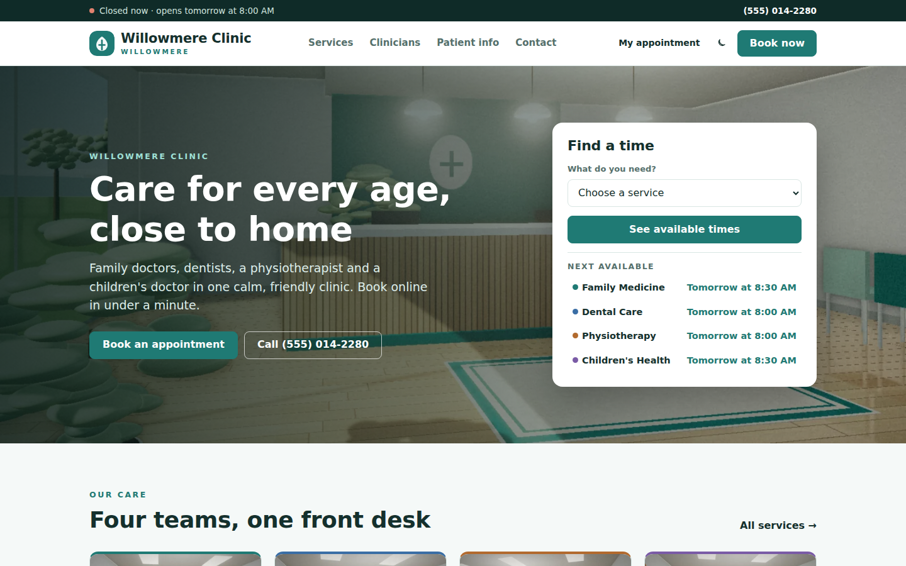

> **Fictional clinic. No medical advice.** Willowmere Clinic and every clinician, patient, service and price are invented. The site books routine visits only; it stores contact details and visit history, never medical notes. The photographs and portraits are painted in code; there are no stock images.

---

## Features

### Clinic website (9 pages)

- **Home:**
  - a hero with **Find a time** (pick a service) and the **next available time** for each team;
  - the teams (Family Medicine, Dental Care, Physiotherapy, Children's Health), an about block, four clinicians, the first-visit steps;
  - opening hours (today highlighted, the next closed day), address and insurance plans.
- **Open now / closed now** bar on every page, worked out in the clinic's own time zone.
- **Services:** every service grouped by team with length, price and the next online time. **Service** pages add what to expect, who offers it and the next free times as one-click buttons.
- **Clinicians:** filter by team. **Profile** pages show the bio, training, languages, room, weekly hours, upcoming time off and every service with its next free time.
- **Book:** four steps on one page, no account needed.
  1. **Service:** filter by team.
  2. **Clinician:** a named clinician, or **First available** (the least busy free clinician is picked for each time).
  3. **Time:** a seven-day strip with the number of free times per day, then times grouped Morning / Afternoon / Evening. Jump to the next free day when a week is full.
  4. **Your details:** new or returning patient, name, phone, email, how to contact you, insurance, the team's booking questions, a note for the front desk and the cancellation rule.
  - The server checks the time again when you confirm, so two people can never book the same slot.
  - **Confirmed:** a booking code like `WC-7Q4RMX` and an **Add to calendar** (.ics) file.
- **My appointment:** look a booking up with the code and the email or phone used.
  - **Change time:** the same day strip, then confirm the move.
  - **Cancel:** free up to 24 hours before (set in Settings). After that the page asks you to call.
  - Wrong guesses are throttled.
- **Patient information:** first visit, what to bring, insurance, changes and cancellations, languages the team speaks and a questions accordion.
- **Contact:** directions (car, bus, bike, access), hours and a message form. Messages arrive on the admin dashboard.
- **Light and dark theme.** Responsive layouts for desktop, tablet and phone.

### How free times are worked out

A time is offered only if it fits **all** of these:

- the clinic's opening hours for that weekday, and not a closed day;
- the clinician's own working hours, outside their break and their time off;
- no other appointment for that clinician, and no other appointment in their room;
- at least *N* hours from now and no more than *N* days ahead (Settings);
- the visit's full length fits before the break or the end of the day.

Times step by the slot length (5, 10, 15, 20 or 30 minutes).

### Clinic admin (13 pages)

- **Sign in** with your own password (PBKDF2). Failed attempts are throttled.
- **Dashboard:**
  - **Today:** appointments, the waiting room, who is in a room, completed and no-shows, time booked (%) and free slots left.
  - **This week:** bookings made online and visits booked for the next seven days.
  - **Lists:** next up, the waiting room with minutes waited, each clinician's hours and load today, website messages and recent activity.
- **Day schedule:** one column per clinician (or per room), 15-minute rows, the time each person isn't working shaded, and a red **now** line.
  - **Click an appointment:** check in, start the visit, complete, mark a no-show, change the time or clinician (free times listed, or any time with **Allow overlap**), cancel with a reason, reopen, and keep a front-desk note. The full history is shown.
  - **Click an empty time:** book a phone, desk or walk-in visit for an existing patient (search by name, phone or email) or a new one. Walk-ins are checked in straight away.
  - Filter by team, show cancelled visits, move day by day and **Print**.
- **Week view:** the whole team as a grid of days (bookings and % booked), or one clinician's week as a timeline.
- **Appointments:** search by code, name or phone, filter by status, clinician, how it was booked and period, with paging. Open any one to act on it.
- **Patients:** search, filters (upcoming visit, seen recently, added recently, not seen for a year) and insurance. A record shows contact details, a front-desk note and every visit.
- **Clinicians:** profile, photo, team, usual room, colour, languages, training, weekly hours with a break, the services they offer and time off. After saving, the admin warns if booked visits now fall outside their hours.
- **Services:** services (length, price, picture, what to expect, who offers it, online or phone only, new patients allowed) and teams (colour, picture and up to six booking questions).
- **Rooms:** each room's use today on a timeline, who is in it now and who uses it.
- **Settings:** clinic details, urgent-care notice, accent colour, theme, the **words** the site uses, opening hours, slot length, booking notice, how far ahead, the cancellation window, time zone, 24-hour clock, showing prices, closed days, insurance plans, website text and the questions list.
- **Users:** a permission matrix for each person, plus "is this person a clinician?" and **only sees their own appointments**.
- **Activity log** and **My account.**

### Appointment statuses

`Booked` → `Confirmed` → `Checked in` → `In room` → `Completed`, or `No-show` / `Cancelled`. Each change is stamped in the appointment's history with who did it.

### Permissions

| Area | Rights | Extra right |
|---|---|---|
| Day schedule (and Week view) | View, Edit | |
| Appointments | View, Edit | **Cancel** |
| Patients | View, Edit | |
| Clinicians | View, Edit | **Time off** |
| Services, Rooms | View, Edit | |
| Activity log | View | |
| Users, Settings | clinic managers only | |

- **Own appointments only:** a clinician linked to their profile sees only their own column, week and appointments.
- The menu shows only the areas a person can see.
- Every check runs on the server. A request the user isn't allowed to make is refused and written to the activity log, even if someone crafts it by hand.

### Live demo mode

With `app.app.runmode | 0` the sign-in page lists the staff. Everyone signs in with the password `demo`.

| User | Role | Can manage |
|---|---|---|
| **avery** | Clinic manager | everything, plus users and settings |
| **jordan** | Front desk | day schedule, appointments (edit + cancel) and patients; clinicians, services and rooms (view) |
| **hart** | Family physician | own appointments only: day schedule and appointments (edit); patients, clinicians and services (view) |
| **okafor** | Dentist | same as hart, for her own column |
| **sofia** | Physiotherapist | same as hart, for her own column |
| **morgan** | Billing | view only: schedule, appointments, patients, services and the activity log |

- **Private copy:** each visitor gets their own copy of the clinic for one hour. A booking made on the website shows up on the day schedule straight away.
- **Dates:** appointments move forward a whole week at a time, so weekdays stay right and the schedule is always busy. Visits earlier today show as completed and the current one as in a room.

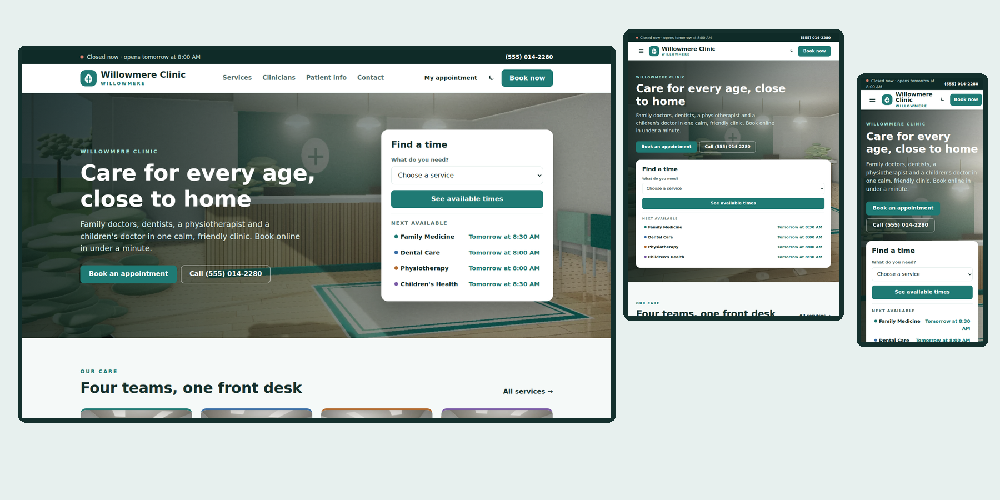

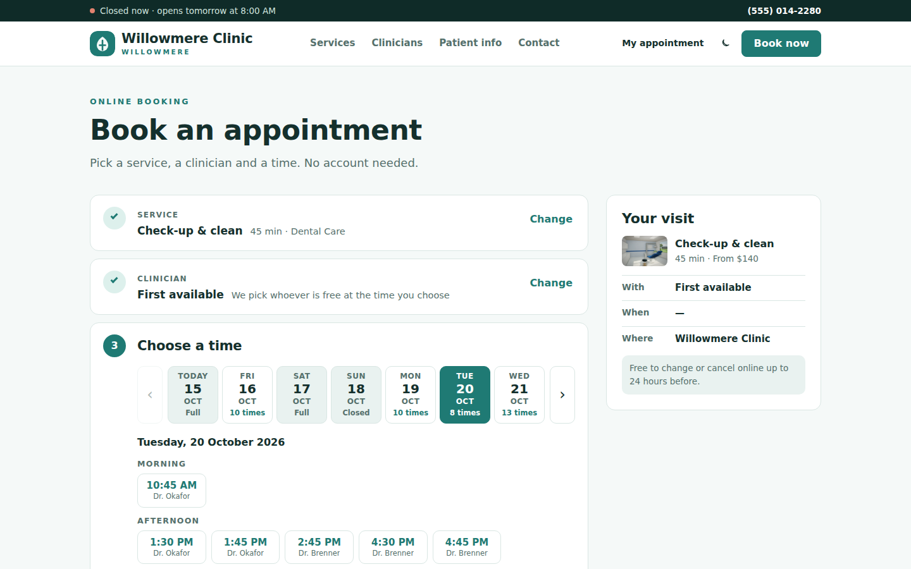

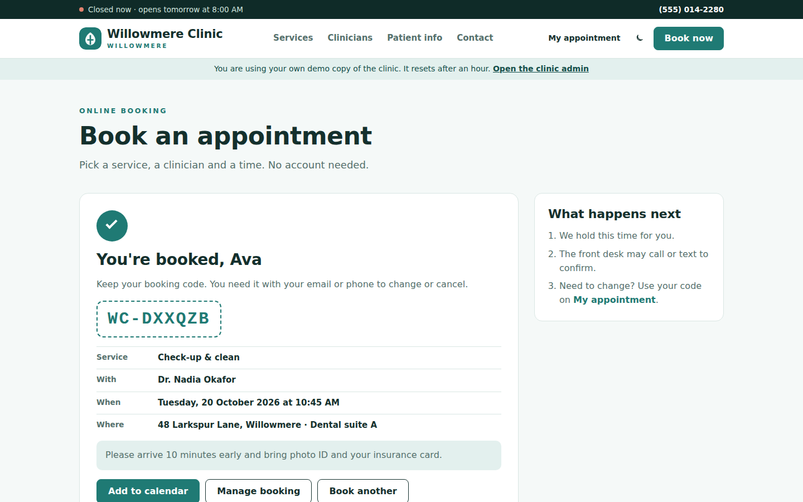

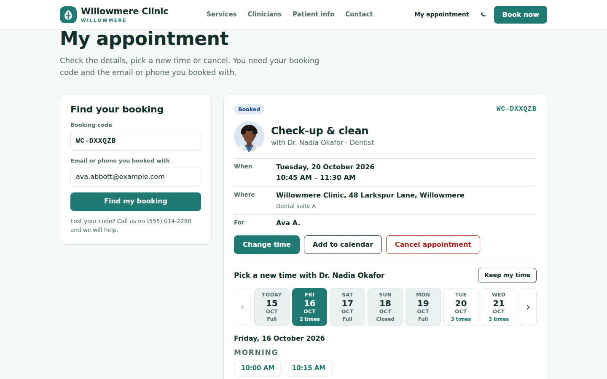

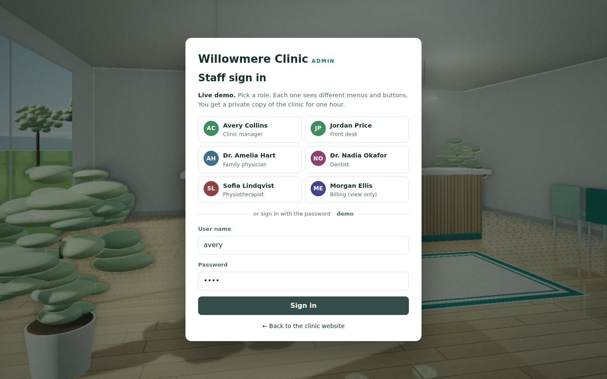

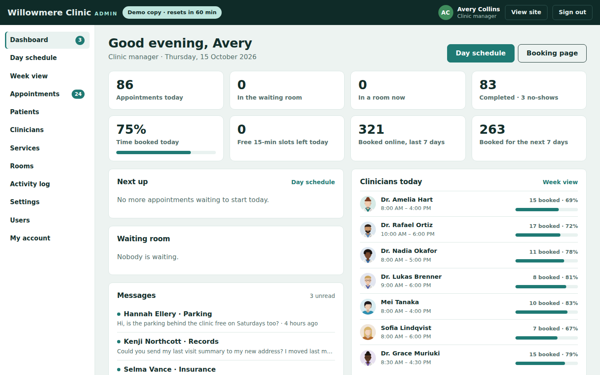

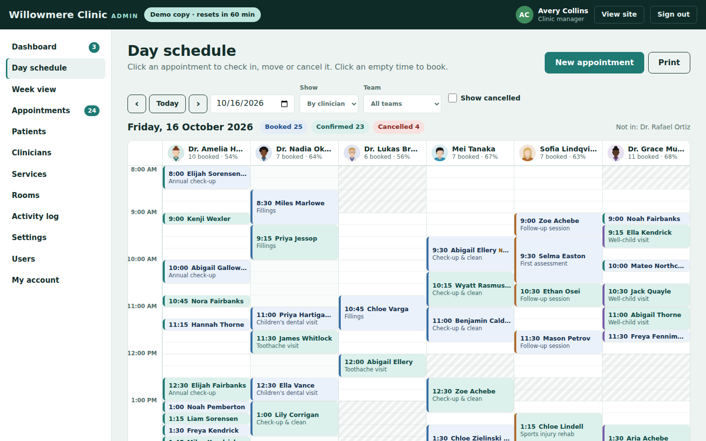

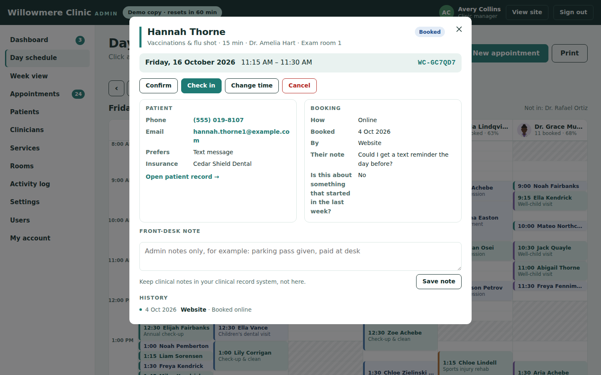

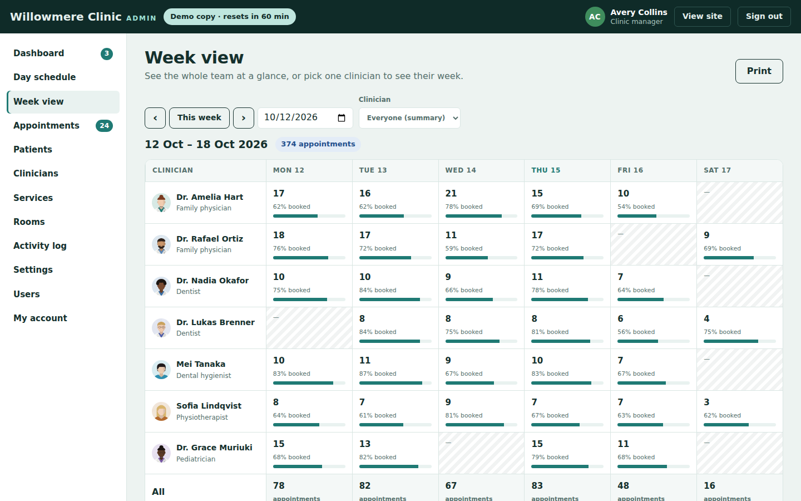

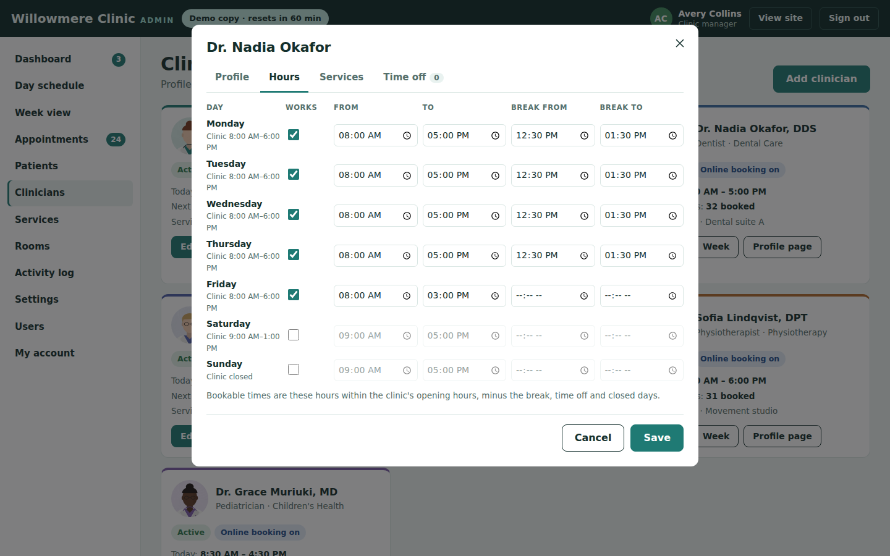

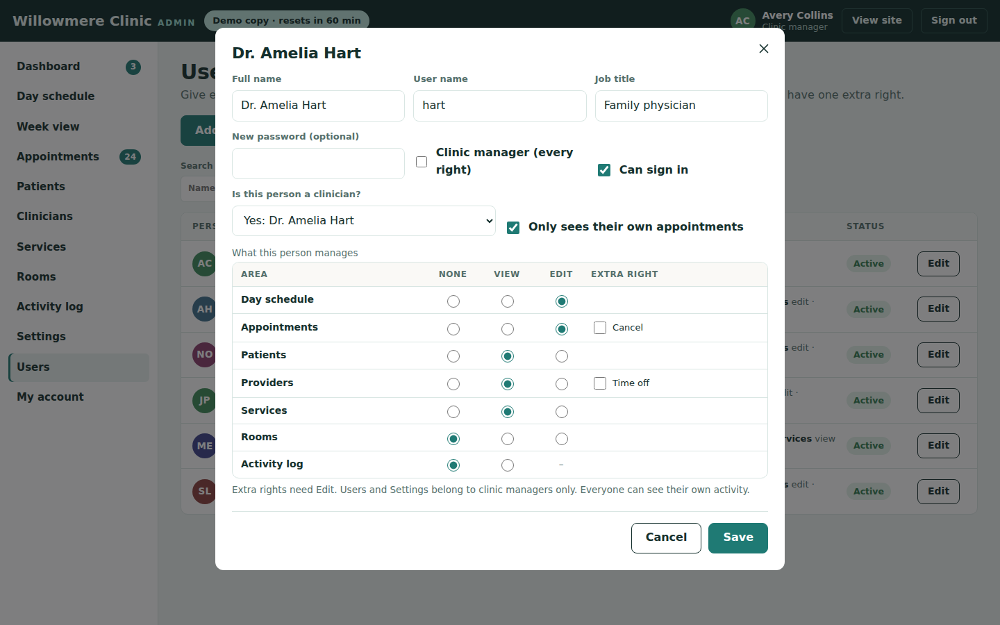

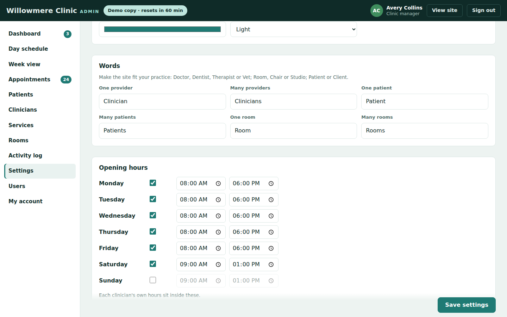

- **Painted photographs:** 8 clinic "photos" (reception, waiting room, consulting room, dental suite, physio studio, children's room, lab and the building) rendered in code by Claude as 16 WebP files, plus 7 clinician portraits.
- **No front-end build:** plain HTML, CSS and vanilla JavaScript; no npm, bundler or SPA framework.
- **No database:** everything lives in three JSON files under `data/`.

---

## Getting started

**Requirements:** .NET 10 SDK and Visual Studio (or any editor with the `dotnet` CLI).

```bash
git clone https://github.com/hkim6000/SkyNet-ClinicWebsite-Asp.net.Core-Full-Source.git
cd SkyNet-ClinicWebsite-Asp.net.Core-Full-Source
dotnet run
```

Or open `Clinic.csproj` in Visual Studio and press **F5**.
The SkyNet package (`TheSkyLite.SkyNet` 1.0.6) restores automatically from NuGet.
The app opens on **Home**, the startup page set in `appConfig/application.cfg`.

**Admin:** click **Staff sign in** in the footer (or open `/AdminLogin`) and pick a role.

---

## Make it yours

1. **Settings:** name, address, phone, email, accent colour, time zone, opening hours, closed days, booking rules and the words (for example `Vet / Vets`, `Client / Clients`).
2. **Services:** rename or replace the four teams, their colours and booking questions, then your services and their lengths.
3. **Clinicians:** add your people, their photos, hours and the services each one offers.
4. **Rooms:** one per chair, room or studio. Each clinician's usual room is checked so two visits never share it.
5. **Pictures:** put your own photos in `images/clinic/full` (1600 px) and `images/clinic/thumbs` (640 px) with the same file name, and portraits (480 × 600) in `images/clinic/people`. They appear in the pickers.

---

## Run it for real (production mode)

1. **Create a password hash** for the first clinic manager. In PowerShell:

   ```powershell
   $p = Read-Host "Password"; [BitConverter]::ToString([Security.Cryptography.SHA256]::Create().ComputeHash([Text.Encoding]::UTF8.GetBytes($p))).Replace("-","").ToLower()
   ```

2. **Edit `appConfig/application.cfg`:**

   ```
   app.app.runmode | 1
   app.admin.user | admin
   app.admin.passhash | <the 64-character hash>
   ```

3. **Sign in as that user.** They become clinic manager. Open **Users** and set a real password for each person who needs access.
   - The sample staff are demo accounts and can't sign in until you set a new password.
   - Turn off the accounts you don't need, or rename them.

4. **Clear the sample data:** start from your own `data/site.json` (settings, teams, services, clinicians and rooms, with empty patients and appointments).

5. **Give the site write access** to two folders. On IIS, grant the application pool identity (for example `IIS AppPool\Clinic`) **Modify** permission on:

   | Folder | What is written |
   |---|---|
   | `data/` | `site.json`, `staff.json`, `activity.json` |
   | `temp/` | staff sessions (`temp/admin`) and demo copies (`temp/sandbox`) |

6. **Use HTTPS.** Session tokens travel in cookies and in each request.

7. **Check your local rules** for storing patient contact details and for online booking in your country.

> **Redeploying:** publishing copies the files in `data/` from your project over the live ones. Download the live `data/` folder first (or exclude it from the publish) so you keep your patients and appointments. `temp/` is not published, but turn off "Remove additional files at destination" so it is not deleted.

In production, staff sessions last 8 hours and renew while you work. Changing a staff password signs that person out everywhere.

---

## Project structure

```
Clinic/
├── appConfig/application.cfg        app settings, run mode, first clinic manager
├── codes/
│   ├── Models/ClinicModel.cs        data DTOs (Specialty, CareService, Clinician, ClinicRoom, Patient, Appointment, ...)
│   ├── Core/Store.cs                JSON storage, demo copies, week shifting
│   ├── Core/Slots.cs                clinic clock, free-time engine, booking codes
│   ├── Core/Access.cs               areas and rights, passwords
│   ├── Core/Auth.cs                 staff sessions, admin menu
│   ├── Core/Ui.cs                   shared HTML helpers, statuses, period filter, paging
│   ├── Home.cs  Services.cs  Service.cs  Providers.cs  Provider.cs  Book.cs
│   │   MyAppointment.cs  PatientInfo.cs  Contact.cs
│   └── AdminLogin.cs  Admin.cs  AdminSchedule.cs  AdminWeek.cs  AdminAppointments.cs
│       AdminPatients.cs  AdminProviders.cs  AdminServices.cs  AdminRooms.cs
│       AdminSettings.cs  AdminUsers.cs  AdminActivity.cs  AdminAccount.cs
├── htmls/  scripts/  styles/        page markup, JavaScript and CSS
├── data/
│   ├── site.json                    settings, teams, services, clinicians, rooms, patients, appointments, messages
│   ├── staff.json                   users, password hashes and rights
│   └── activity.json                the activity log (latest 5,000)
├── images/clinic/full/  clinic/thumbs/  painted photos (1600 px and 640 px, WebP)
├── images/clinic/people/            clinician portraits (WebP)
├── temp/                            sessions and demo copies (created at run time)
└── Program.cs
```

### One page = four files, one name

| File | Holds |
|---|---|
| `codes/AdminSchedule.cs` | the page class (`: WebPage`) and its server methods |
| `htmls/AdminSchedule.html` | markup with `{plhd_*}` placeholders |
| `scripts/AdminSchedule.js` | one IIFE namespace, `AdminScheduleJs` |
| `styles/AdminSchedule.css` | styles, every class prefixed (`sc-`) |

---

## SkyNet in action

The browser calls a C# method, the method returns an `ApiResponse`, and only those parts of the page change.

```js
// scripts/AdminSchedule.js
api('Act', [{ key: 'id', vlu: id }, { key: 'act', vlu: 'checkin' }]);
```

```csharp
// codes/AdminSchedule.cs
if (!Access.Can(c.U, AreaKey, 'E'))
{
    return await Refuse(response, c, act, id, "You can look but not change appointments.");
}
...
"checkin" when from is "booked" or "confirmed" => ("arrived", "Checked in"),
...
response.SetElementContents("sc-mbody", Detail(site, c, a, staff));
response.ExecuteScript("AdminScheduleJs.refresh();AdminScheduleJs.toast('Checked in');");
```

| Page | Requests |
|---|---|
| every public page | `Hydrate` (the visitor's demo copy) |
| Book | `Step`, `Confirm` |
| MyAppointment | `Find`, `Times`, `Move`, `Cancel` |
| Contact | `Send` |
| every admin page | `Load`, `SignOut` (AdminLogin: `SignIn`) |
| Admin | `Msg` |
| AdminSchedule | `Grid`, `Open`, `Act`, `Desk`, `MoveForm`, `Move`, `NewForm`, `PFind`, `Create` |
| AdminAppointments | `List` and the same appointment requests |
| AdminWeek | `Week` |
| AdminPatients | `List`, `Record`, `SavePt` |
| AdminProviders / AdminRooms | `Form`, `Save` |
| AdminServices | `List`, `SvForm`, `SaveSv`, `TeamForm`, `SaveTeam` |
| AdminUsers / AdminSettings / AdminAccount / AdminActivity | `List`, `Form`, `Save` / `Save` / `Save` / `List` |

Learn more: [SkyNet Developer Guide](https://www.theskylite.com/documents/SkyNet_Developer_Guide.html)

---

## 100% AI-driven coding

Every file in this template was generated by Claude (Anthropic's AI) from short instructions, directed and reviewed by the author: C#, HTML, CSS, JavaScript, the painted photographs, the portraits and the data.
No line was written by hand.

| | |
|---|---|
| Pages | 22 (9 public, 13 admin) |
| Lines of code | ~23,000 (C#, HTML, CSS, JavaScript) |
| Images | 8 painted photos (16 WebP) and 7 portraits |
| Teams / services / clinicians / rooms | 4 / 17 / 7 / 7 |
| Sample data | 600 patients, about 3,300 appointments over ten weeks |
| Lines written by hand | 0 |

SkyNet's page model is small and predictable: one class, four files, `$ApiRequest` → `ApiResponse`.
With so few, consistent rules, AI can generate complete, working pages with very few errors.

---

## License

- **This template** (all source files, artwork and data in this repository): [MIT License](LICENSE). Free to use, modify and redistribute, including commercially.
- **SkyNet Framework** (`TheSkyLite.SkyNet` NuGet package): proprietary, free to use including commercial use; see the license included in the package.

---

## Links

- Live demo: https://www.theskylite.com/Clinic
- SkyNet Framework: https://www.theskylite.com
- More website templates: https://www.theskylite.com/SkyNetTemp
- NuGet package: https://www.nuget.org/packages/TheSkyLite.SkyNet
- SkyNet Agent (build your own site with Claude Code): https://github.com/hkim6000/SkyNet-Agent
- Template #1 — Beauty store: https://github.com/hkim6000/SkyNet-BeautyWebsite-Asp.net.Core-Full-Source
- Template #2 — Pharma company: https://github.com/hkim6000/SkyNet-PharmaWebsite-Asp.net.Core-Full-Source
- Template #3 — Travel blog: https://github.com/hkim6000/SkyNet-TravelWebsite-Asp.net.Core-Full-Source
- Template #4 — Fast food restaurant: https://github.com/hkim6000/SkyNet-FastFoodWebsite-Asp.net.Core-Full-Source
- Template #5 — Fine dining restaurant: https://github.com/hkim6000/SkyNet-FineDiningWebsite-Asp.net.Core-Full-Source
- Template #6 — Car dealership: https://github.com/hkim6000/SkyNet-CarDealerWebsite-Asp.net.Core-Full-Source
- Template #7 — Web comic: https://github.com/hkim6000/SkyNet-WebComicWebsite-Asp.net.Core-Full-Source
- Template #8 — Art gallery: https://github.com/hkim6000/SkyNet-ArtGalleryWebsite-Asp.net.Core-Full-Source
- Template #9 — Artist blog: https://github.com/hkim6000/SkyNet-ArtistBlogWebsite-Asp.net.Core-Full-Source
- Template #10 — Newspaper: https://github.com/hkim6000/SkyNet-SkyLitePostWebsite-Asp.net.Core-Full-Source
- Template #11 — Hotel: https://github.com/hkim6000/SkyNet-SkyHotelWebsite-Asp.net.Core-Full-Source
- SkyNet project template: https://github.com/hkim6000/ASPNETCoreEmpty.SkyNet

© 2026 HC Kim
